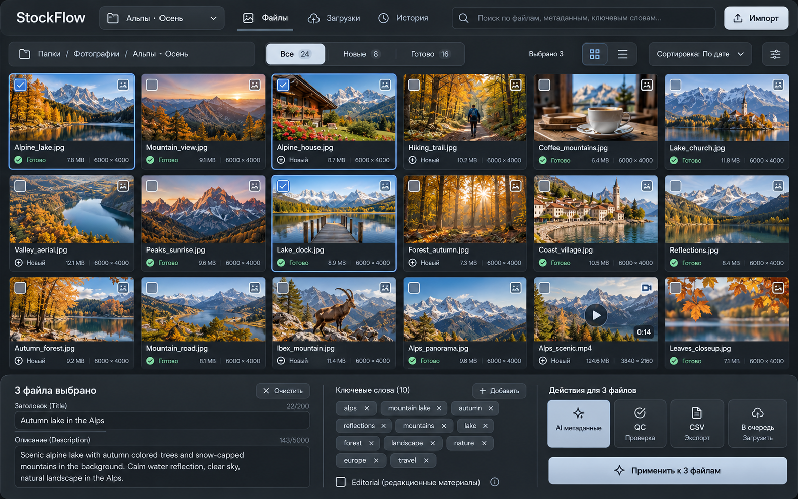

# StockFlow Workspace Вариант 10

Статус: направление выбрано пользователем 29 октября 2026 года; **реализовано 29 октября 2026** (тёмная тема). Контракт остаётся источником истины для поведения; внедрённые константы — `lib/core/theme/design_tokens.dart`, отклонения и ограничения — в конце `DESIGN.md`, раздел «Реализованные ограничения».

- [Дизайн-система](../../../DESIGN.md)
- [Целевые токены](tokens.json)
- [Утверждённое изображение](reference.png)
- [Задание агенту](../../agent-prompts/stockflow-redesign-10.md)

## 1. Что выбрано и что обязательно сохранить

Рабочая область состоит из четырёх горизонтальных зон: глобальная панель, контекст и фильтры, большая фотосетка, общий редактор снизу. **В workspace нет постоянного левого сайдбара и правого инспектора.** Нижний редактор занимает всю ширину и не перекрывает последние карточки сетки.

На эталоне примерно шесть колонок и три ряда, тёмный графит, синие рамки выбранных файлов, светлые пыльно-синие кнопки. Зафиксированы композиция и характер; количество рядов, данные и подписи автоматически подстраиваются под реальное содержимое. Фотографии из PNG не являются ассетами приложения.

Сохранить папки/подпапки/workspaces, проекты, привязки папок, коллекции, отбор, поиск и фильтры, фото и видео, AI и Editorial, ручные метаданные, CSV импорт/экспорт, QC, очередь и её существующие ограничения, историю, настройки и доступ к остальным текущим разделам. Готовность к загрузке нельзя вычислять по цвету карточки или наличию заголовка.

## 2. Глобальная панель

Одна строка на широком окне: StockFlow → выбор проекта/области → вкладки «Файлы», «Загрузки», «История» → поиск → «Импорт». Высота `appBar`, боковые отступы `pagePadding` из tokens.json. Не дублировать строку поиска ниже.

Название текущей области открывает навигационный popover; в узком окне — drawer. В нём переиспользовать текущие разделы папок, проектов, коллекций и отбора, включая создание/редактирование и контекстные действия. Поповер не является урезанным вторым источником данных. Смена области идёт через существующие providers и сохранение черновика.

Уточнить текущий смысл «Загрузки» и «История»: если они открывают один экран с разными фильтрами, использовать этот экран и реальные фильтры, не создавать независимые дублирующие очереди. Настройки, аналитика и другие существующие пункты доступны через overflow/меню приложения. Для неготовой функции сохранить реальное текущее состояние, не рисовать работающую аналитику.

«Импорт» — меню существующих операций «Добавить файлы», «Открыть папку», «Импорт CSV» по фактической поддержке. Добавление медиа не запускает AI, запись в файлы или отправку на сток автоматически. Поиск работает в существующей выбранной области; не расширять охват поиска одним редизайном.

## 3. Контекст и фильтры

Следующая строка: breadcrumb папки/проекта/коллекции, сегменты состояния, счётчик выделения, переключатель сетка/список, сортировка и дополнительные фильтры. Высота `scopeBar` на широком окне. Breadcrumb сжимается и показывает полный путь в tooltip.

Сегменты «Все», «Новые», «Готово» — представление текущих фильтров, не новая модель статусов. «Готово» должно иметь явно определённый существующий предикат и точную подсказку, например «Готово к загрузке», если это соответствует модели. Нельзя приравнивать metadata_ready к ready_to_upload во всём приложении: модель очереди сейчас допускает оба по своей функции `canBeQueuedForUpload`; редизайн её не меняет. Остальные состояния остаются доступны в дополнительных фильтрах.

Числа рассчитываются для текущей области и согласованного набора фильтров; счётчик выделения отражает реальное выделение, включая скрытое фильтром, если таков существующий контракт. При скрытых выбранных файлах показать явную подпись «из них скрыто: N». Не менять сохранённые scope, сортировку и фильтры без пользовательского действия.

## 4. Сетка и карточки

Сетка — единственная расширяющаяся и вертикально прокручиваемая средняя зона. Строить лениво, сохранять RepaintBoundary/кэш миниатюр и позицию прокрутки. Не читать оригиналы полного разрешения для каждой карточки при каждом rebuild.

Ширина карточки определяется доступной шириной и выбранной существующей плотностью. Базовая формула для стандартной плотности: `columns = max(1, floor((availableWidth + gridGap) / (preferredCardMinWidth + gridGap)))`; `availableWidth` уже исключает внешние отступы. Остаток распределяется между карточками. Шесть колонок — ориентир широкого окна, не жёсткое условие. Сохранить существующее управление размером миниатюр, если оно есть.

В карточке сверху изображение с `BoxFit.cover` только для thumbnail, ниже две компактные строки. Первая: filename с ellipsis и меню. Вторая: иконка + статус, размер, разрешение; при нехватке места второстепенные данные уходят в tooltip. Вертикальные/горизонтальные фото и видео не меняют геометрию сетки. Полный просмотр показывает исходный аспект, не обрезанный thumbnail.

Checkbox всегда доступен; на выбранной карточке — checked и обводка `selection`. Клавиатурный focus имеет отдельный внешний контур и не означает выбор. Checkbox и меню не должны повторно вызывать клик карточки через всплытие. Сохранить `SingleClickArea` по docs/UI_CONVENTIONS.md.

Перед изменением поведения изучить текущий контракт: обычный клик фокусирует/выбирает; модификаторы Cmd/Ctrl и Shift сохраняют текущее поведение множественного выбора. Не изобретать несовместимую схему. Полный просмотр доступен через существующее действие/меню/клавиатуру без постоянного инспектора.

Статусы отображать по существующей модели, предложения русских подписей:

| Storage value | Подпись | Маркер |
|---|---|---|
| new | Новый | плюс/круг |
| metadata_ready | Метаданные готовы | документ |
| qc_failed | Нужна правка QC | предупреждение |
| ready_to_upload | Готов к загрузке | галочка |
| uploaded | Загружен | облако/стрелка |
| submitted | Отправлен на проверку | подтверждение |

Последнюю подпись сверить с реальной семантикой отправки; storage values не переименовывать. Теги AI и Editorial независимы от workflow status. Сохранить видимость недоступного диска/файла и ошибки thumbnail. Видео имеет play и длительность только если они реально известны; сохраняются текущие ограничения записи метаданных видео.

## 5. Нижний редактор

Редактор включён в вертикальную раскладку через собственную ограниченную высоту, а не Positioned поверх галереи. По умолчанию `editorDefaultHeight`, три колонки примерно 41/27/32 процента с тонкими разделителями и отступами. Левый блок: счётчик и «Снять выделение», заголовок, описание. Средний: ключевые слова, добавление/удаление, Editorial и его существующие дополнительные поля. Правый: AI, QC, CSV, очередь, главное применение.

При недостатке высоты допускается ручное изменение высоты/сворачивание редактора. Эту небольшую UI-логику добавлять только если текущего поведения недостаточно; не строить отдельный менеджер docking-панелей.

### 0 файлов

Свернуть до строки `editorCollapsedHeight`: «Выберите файлы для редактирования». Массовые действия недоступны с объясняющей подсказкой. Импорт остаётся доступен. Состояние не должно самопроизвольно менять область поиска.

### 1 файл

Показать реальные значения и несохранённый черновик выбранного файла. Главная кнопка «Сохранить изменения». Неприменимые для типа файла операции отключены с объяснением. AI-результат не должен перезаписывать чужой файл после смены scope/выделения.

### Несколько файлов

Это контракт безопасности предлагаемого редактора; агент сначала проверяет существующую реализацию и переиспользует её, не вырезая защиту:

- Общие значения показываются как значения. Различающиеся — «Разные значения», это placeholder, который никогда не сохраняется в метаданные.
- Изменение title/description применяется только при явном редактировании соответствующего поля. Неизменённое поле сохраняет индивидуальные значения файлов. Пустое поле, которое пользователь не редактировал, не означает очистку.
- Очистка существующего значения — явное действие для поля. «Снять выделение» не очищает данные и не заменяется кнопкой «Очистить всё».
- Для ключевых слов безопасный исходный режим — **добавить к выбранным**, сохранив индивидуальные ключи, порядок и правила дедупликации. Полная замена — отдельный явно названный режим. Удаление общего чипа должно ясно означать удаление только этого ключа у выбранных файлов.
- Editorial — tri-state при разных значениях. Нетронутое смешанное состояние ничего не меняет; дополнительные город/страна/дата доступны без потери текущей валидации и формата. Тег AI не удаляется вместе с Editorial.
- Главная кнопка «Применить к N файлам» активна только при валидных изменениях. Подпись/сводка сообщает режимы применения полей и ключей до записи.
- На старте операции захватить IDs/paths и scope как неизменяемый контекст; смена выделения во время await не меняет цель. Повторное нажатие не запускает дубль.
- Успех показывать по фактическому результату; при частичной ошибке назвать успешные/неуспешные файлы, оставить ошибочные правки доступными для повтора.

Если точная безопасная batch-семантика ещё не поддержана, реализовать минимально необходимый контракт с тестами. Не подключать кнопку «Применить к N» к функции, сохраняющей один focused file. Не маскировать пробел бизнес-логики визуально работающей кнопкой.

### Незавершённые изменения

Смена scope, файла, выделения и закрытие панели сохраняют существующий механизм `_preserveUnsavedDraft`. Сохранённый черновик UI и запись в исходный файл — разные операции. Если гарантировать безопасное сохранение нельзя, предложить «Сохранить / Отбросить / Остаться»; никакой тихой потери правок и записи по новому выделению.

### Действия

AI использует существующий контекст и настройки. QC запускает существующую проверку; не подменять её списком галочек из картинки. CSV экспорт сохраняет текущий формат и правила selection/scope. «В очередь» использует существующий фильтр допуска и целевые стоки, не означает мгновенную публикацию. Если перед очередью нужны сохранённые метаданные, явно выполнить существующий валидируемый поток или сообщить об этом, не обходить его.

## 6. Адаптация окна

| Размер | Поведение |
|---|---|
| От 1440 по ширине | Две верхние строки, большая сетка, редактор в 3 колонки |
| 1100–1439 | Поля и кнопки сжимаются до допустимых размеров; второстепенные действия в overflow, grid адаптивный |
| Уже 1100 | Контекстная строка может стать двумя; редактор использует вкладки «Текст / Ключи / Действия», остаётся снизу на всю ширину |
| Малая высота | Ограничить editorMaxHeightFraction, внутри редактора разрешить scroll; не выдавливать сетку ниже gridMinVisibleHeight |

Если сумма минимальных размеров не помещается (например, text scaling 150%), нижний редактор сворачивается в компактную строку с открытием доступного sheet. Не обрезать форму и кнопки. Минимальный размер окна проекта не увеличивать ради удобства реализации. Это адаптация desktop, мобильное приложение в задачу не входит.

Не фиксировать всё в абсолютных координатах. OS titlebar/safe areas учитываются отдельно. При одинаковых 1600×1000 должны читаться пропорции эталона; число рядов может меняться при других размерах.

## 7. Обязательные состояния и доступность

Пустая папка, ничего не найдено, loading, thumbnail failure, диск отключён, нет прав записи, AI failure/cancel, частичный результат, 0/1/N selected, смешанные поля, dirty и clean, busy, ошибки валидации. Меню и popover доступны с клавиатуры, Escape закрывает верхний transient слой; Escape в поле не должен молча уничтожать правки. Нативный ввод и clipboard работают без глобального перехвата Cmd+A/Ctrl+A.

Контраст обычного текста минимум 4.5:1, значимых границ/focus 3:1 к соседней поверхности. Проверить rendered цвета, градиенты, disabled и text scaling 125/150%, не только hex пары. Tooltip не единственный способ узнать критическую ошибку. Семантические имена, Tab order, focus return после закрытия меню, статус плюс иконка обязательны.

## 8. Приёмка

1. На 1600×1000 тёмный workspace узнаваем как вариант 10: большая сетка на всю ширину, нижний редактор, никаких постоянных боковых панелей.
2. Папки, проекты, коллекции, отбор, импорт, поиск, сортировка и фильтры реально доступны и используют прежние данные.
3. Проверены одиночное/множественное выделение и отсутствие двойного срабатывания checkbox/menu.
4. Проверены 0/1/N, dirty/scope switch, смешанные значения, явная очистка и добавление/замена ключей без потери индивидуальных значений.
5. AI/сохранение не меняют целевой набор после смены selection; busy не запускается повторно.
6. CSV, QC, очередь, Editorial и AI-теги сохраняют реальные контракты. Статусы и счётчики не взяты из PNG.
7. На 1280×800 и минимальном поддерживаемом окне нет overflow/недоступных полей; при text scaling сохраняется доступ к действиям.
8. Есть реальный скриншот приложения и честный перечень запущенных проверок; концепт PNG не выдаётся за скриншот реализации.

Не проверено на этапе документации: реальная доступность, производительность и все UI-переходы. Риски реализации — смешанные batch-значения, потеря черновика, сохранение видео и навигация после удаления постоянного сайдбара. Они входят в обязательную приёмку, а не считаются решёнными документом.

## 9. Отчёт о реализации

- Оболочка: постоянный сайдбар удалён; одна глобальная панель с wordmark, popover области (рабочие области, папки, проекты, коллекции, «Отбор»), вкладками «Файлы / Загрузки / История», единым поиском и меню «Импорт». Настройки, стоки и аналитика — в overflow; настройки стоков дополнительно доступны из overflow, чтобы не потерять раздел после удаления сайдбара.
- Workspace: строка контекста (breadcrumb, сегменты «Все / Новые / Готово», счётчик выделения с «из них скрыто», переключатель сетка/список, сортировка, фильтры типа и тегов), ленивая сетка по формуле из §4, нижний редактор на всю ширину в трёх колонках 41/27/32.
- Batch-контракт: mixed-значения — только placeholder `Разные значения`; неизменённые поля не применяются; явная очистка отдельной кнопкой; ключи по умолчанию добавляются, замена — отдельным режимом; Editorial и AI-тег tri-state; цели и записи БД захватываются до первого await; повторное применение блокируется, смена выделения во время записи игнорируется; частичные ошибки перечисляются по файлам.
- Ответы 0/1/N: 0 — свёрнутая строка; 1 — существующие контроллеры и `_preserveUnsavedDraft`; N — staged-черновик с подтверждением «Применить / Отбросить / Остаться» при смене выделения или области.
- Загрузка и очередь не переписывались: используются существующие допуск, стоки, QC и `UploadProtocol.sftp`.
